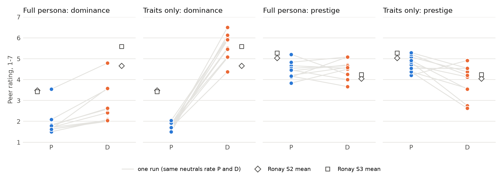
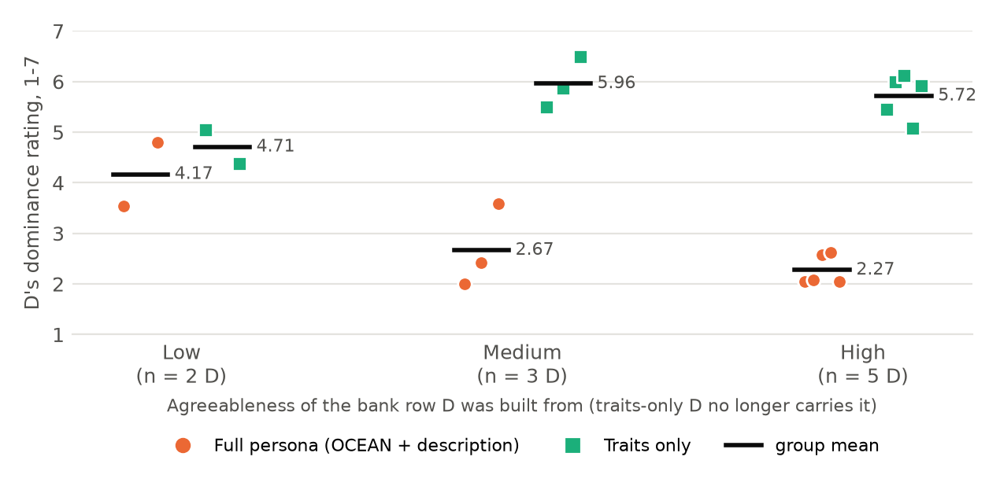

% Step 1: Why the P/D Check Failed, and a Fix
% agent-sim / dp_check
% 2026-10-13

# Last time: the P/D check failed

| Condition | Scale | Expected | D | P | p | d_av | |
|------------|------------|----------|------|------|-------|-------|------|
| Routine | Dominance | D > P | 2.77 | 1.90 | .0006 | 1.14 | Pass |
| Routine | Prestige | P > D | 4.51 | 4.45 | .74 | −0.15 | Fail |
| Threat | Dominance | D > P | 3.15 | 1.77 | .016 | 1.74 | Pass |
| Threat | Prestige | P > D | 4.32 | 4.64 | .059 | 0.92 | Fail |

- Gate: all 4 must pass. 2 of 4 did
- Ronay et al. (2023), same scale: D on dominance 4.66-5.59

::: notes

上次報告的結果：neutral 開完會後，用 Cheng et al. (2010) 的量表評 P 和 D（1-7 分）。四個檢定要全部通過才算過關，結果只過了兩個。

- Dominance 兩個條件都過了，但分數很低：D 只有 2.8-3.2，Ronay 的人類受試者給 D 的分數是 4.7-5.6。
- Prestige 兩個條件都沒過：routine 方向相反，threat 的 p = .059。

這次要回答：為什麼失敗？

:::

# Cause: D's description contradicts its traits

| Agreeableness of D's bank row | n | D's description says | D's dominance (routine) |
|-------------------|------|------------------------------------------------------|----------------|
| Low | 2 | "skeptical, competitive, and direct" | 4.17 |
| Medium | 3 | "polite but firm", "without dominating the conversation" | 2.67 |
| High | 5 | "keep the atmosphere harmonious", "gentle, cooperative tone" | 2.27 |

::: notes

**重點**：P 和 D 用同一列 bank 資料建立（同樣的 OCEAN、同樣的描述），traits 叫 D「控制別人」，但一半 D 的描述叫它「溫和」。

P_i 和 D_i 用同一列 bank 資料建立，所以 D 也帶著那一列的 OCEAN 和描述文字。

10 個 D 裡有 5 個來自高親和性（agreeableness）的列，描述寫著「讓氣氛和諧」「溫和、合作」。同一個 D 的 traits 卻寫著「重視控制和權威」「用獎懲讓人照自己的意思做」。模型把兩者折衷，D 就變成「講話直接、但很體貼的協調者」。

數字很一致：描述越溫和，D 越不被看成 dominant（4.17 → 2.67 → 2.27）。分數最高的 D12，描述本身就是「多疑、好勝、直接」，和 traits 一致。

:::

# What D actually did in the meetings

| | Push phrases / 100 words | Inclusive phrases / 100 words |
|-----------------|----------------|----------------|
| D | 2.55 | 1.73 |
| N | 1.05 | 2.03 |
| P | 0.62 | 3.70 |

- D pushed ("let's move", "enough"), but did not intimidate
- "Members of your group are afraid of him/her": D 1.17, P 1.07 (1-7)
- No D ever used reward or punishment: nobody is in charge, nothing to give or take

::: notes

我讀了每一場會議 D 的發言（routine，10 場）。

- traits 確實有作用：D 用「推進、壓制」類用語的頻率是 P 的 4 倍。
- 但 D 只是急著推進，沒有威嚇別人。「大家怕他」這一題 D 只有 1.17 分，而讓人害怕正是 Cheng 量表裡 dominance 的核心。
- 會議裡沒有人被任命，也沒有獎金或資源，所以 D 沒辦法用 traits 裡的「獎懲」。Ronay 的 D 則握著受試者的獎金。

:::

# Test: P and D with traits only

- Remove OCEAN and description from P and D; keep `traits`. Neutrals unchanged
- Routine, 10 runs, same tasks and neutrals as last time, run by run
- Cost: 211 gpt-4.1 calls
- Predicted before running
    1. Dominance rises
    2. Prestige still does not separate

::: notes

**只改一個東西**：P 和 D 的 persona 只留 traits。neutral、題目、抽樣種子都和上次一樣，所以新的 run i 和舊的 run i 可以逐一比較。

跑之前先寫下預測，避免看到結果才解釋：

1. Dominance 會上升。
2. Prestige 可能還是拉不開。我當時認為 prestige 失敗主要是環境造成的：HiddenBench 裡每個人都有線索可以分享，大家看起來都有能力。

:::

# Result: both scales pass

| | Full persona | Traits only | Ronay S3 |
|--------------------|-------------------|-------------------|-----------|
| D on dominance | 2.77 | **5.59** | 5.59 |
| P on dominance | 1.90 | 1.77 | 3.42 |
| P on prestige | 4.45 | 4.75 | 5.28 |
| D on prestige | 4.51 | **3.92** | 4.24 |
| Dominance, D > P | p = .0006 | p < .0001 | |
| Prestige, P > D | p = .74 ✗ | **p = .0098 ✓** | |

- D on dominance now equals Ronay Study 3
- Prestige separates because D lost esteem, not because P gained it

::: notes

- **Dominance**：D 從 2.77 升到 5.59，和 Ronay Study 3 一模一樣。
- **Prestige**：從失敗變成通過。主要是 D 的 prestige 掉了（4.51 → 3.92），P 只小幅上升。
- 預測 1 正確；**預測 2 錯了**：拿掉描述後 prestige 也通過，代表描述文字不只削弱了 D 的 dominance，也讓 D 顯得好相處，保住了它的聲望。

P 在 dominance 上還是遠低於 Ronay（1.77 vs 3.42），LLM 評分者給不 dominant 的人的分數比人類低很多。

:::

# Every run, before and after

::: notes

同樣的 10 個 run，每個量表左格是原本的 persona，右格是 traits only。

**原本的 persona（左格）**：只有少數 run 的 D 被看成 dominant（routine 10 個裡只有 2 個明顯偏高），其他 run 的 D 和 P 幾乎一樣低；prestige 的 P 和 D 擠在一起。所以上次的問題不是「效果小一點」，而是多數 run 裡 D 根本沒被看出來。

- Dominance：traits only 時，**每一個** run 的 D 都在 4.4-6.5，和 P 完全分開。
- Prestige：traits only 時，10 個 run 裡有 8 個是 P 高於 D。

唯一沒有上升的是 D12（4.79 → 4.38），它原本的描述就和 traits 一致。

:::

# The description effect disappears

::: notes

橘色是原本的 persona，綠色是 traits only。x 軸是 D 原本那一列 bank 資料的親和性。

- 原本：親和性越高，D 越不 dominant。
- Traits only：中、高親和性的 D 都跳到 5.7-6.0。

這直接支持「描述文字稀釋了 traits」這個解釋。

:::

# Do not compare d here: compare means

| Scale | Traits-only: high group, M (SD) | Low group, M (SD) | d_av |
|------------------|--------------------|--------------------|-------|
| Dominance | D 5.59 (0.63) | P 1.77 (0.16) | **9.77** |
| Prestige | P 4.75 (0.38) | D 3.92 (0.77) | 1.45 |
| Ronay S3, dominance | D 5.59 (0.98) | P 3.42 (1.10) | 2.08 |

::: notes

d_av = 9.77 看起來很誇張，但不能和 Ronay 的 2.08 比較。

d 是「差距 ÷ 標準差」。traits-only 版本的 10 個 D，persona 文字完全一樣（只有名字不同），LLM 評分者又非常一致，所以 SD 只有 0.63 和 0.16，Ronay 的人類受試者是 0.98 和 1.10。分母小了很多，d 就被放大。

所以這次比較平均數：D 在 dominance 上 5.59，和 Ronay Study 3 一樣。

:::

# Takeaways and next steps

- Failure cause: the shared bank description diluted P/D traits
- Traits alone are read as intended (routine): dominance and prestige both pass
- My prediction for prestige was wrong; the environment was not the main cause
- Next
    - Run threat with traits only (about 210 calls)
    - Decide whether the main experiment uses traits-only P and D

::: notes

**結論**：上次失敗的主因，是 P 和 D 共用的 bank 描述文字稀釋了 traits。拿掉之後，routine 條件下 dominance 和 prestige 都通過。

**接下來**：

1. threat 條件還沒測，約 210 次 gpt-4.1 呼叫。
2. 主實驗（ffni_mediation）要不要改用 traits-only 的 P、D：
   - 好處：P 和 D 只差在 traits，刺激乾淨一致。
   - 代價：P、D 沒有個體差異，N 會和兩個比較扁平的角色開會。
   - 如果改了，進入 Step 2 前要用最終版本的 persona 重跑一次完整的檢核。

:::
